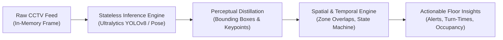
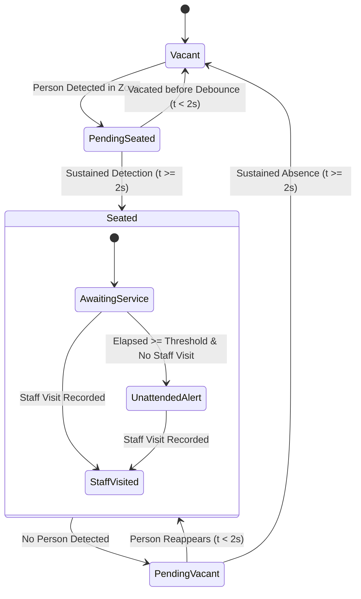

# AI-Native Build Architecture — SeeServe

> **Hackathon Submission Reference**: AI Builders Congress 2026  
> **Platform**: SeeServe — Ambient Computer Vision Floor Intelligence  
> **Author**: Mahmudul & The SeeServe Engineering Team

---

## 1. Executive Summary & AI-Native Paradigm

Traditional restaurant floor management systems rely on manual input (hostess stands, POS punch-ins, staff observation) or invasive physical hardware (call buttons on tables, under-table weight sensors, RFID tags). These solutions create friction, require expensive maintenance, and suffer from human compliance failure during peak rushes.

**SeeServe** is designed from the ground up as an **AI-native ambient intelligence platform**. Instead of treating computer vision as a decorative add-on or a detached post-processing script, SeeServe treats existing standard overhead CCTV camera streams as continuous, high-entropy cognitive sensor feeds.



### Core Design Principles
1. **Decoupled Perception vs. Reasoning**: Heavy neural networks only identify *what* is in the frame (people, chairs, keypoints). All restaurant domain rules, temporal hysteresis, and spatial correlations are executed in deterministic, ultra-fast domain logic.
2. **Pluggable Model Architecture**: Zero lock-in to a single computer vision framework or API vendor.
3. **Zero-Footage Ephemeral Processing**: Video frames exist only in transient memory during inference and are instantly discarded—ensuring zero guest privacy intrusion.
4. **Adaptive Cultural Context**: Dynamic operational modes (such as **Standard** vs. **Iftar Mode**) that adapt temporal alert thresholds to cultural dining patterns.

---

## 2. System Architecture & Module Boundaries

SeeServe follows strict Clean Architecture and Hexagonal Architecture (Ports and Adapters) principles within a TypeScript monorepo (`apps/web` and `apps/api`).

```
seeserve/
├── apps/
│   ├── web/                    # Presentation Layer (Next.js 16 + React 19)
│   │   ├── src/features/dashboard/
│   │   │   ├── dashboard.tsx   # Floor status, real-time alerts feed, interactive zones
│   │   │   (frame sampling with OffscreenCanvas lives in dashboard.tsx)
│   └── api/                    # Core Engine (Node.js + Express + TypeScript)
│       ├── src/
│       │   ├── domain/         # Pure business logic & entities (Zero dependencies)
│       │   │   ├── demo/       # Table state machine, hand-raise rules, alert definitions
│       │   │   ├── tables/     # Table entity & lifecycle contracts
│       │   │   └── vision/     # Normalized Detection, Keypoints, and InferenceProvider Port
│       │   ├── application/    # Application services & use-case orchestrators
│       │   │   └── demo/       # DemoSession coordinator, spatial mapping, occupancy logic
│       │   ├── infrastructure/ # External adapters & implementations
│       │   │   ├── inference/  # Ultralytics API, YOLOv8-pose HTTP, Mock provider
│       │   │   ├── database/   # PostgreSQL connection pool & migrations
│       │   │   └── repositories/ # Event & Table persistence adapters
│       │   └── interfaces/     # Primary entry points (HTTP REST controllers)
```

### Module Responsibilities:
- **`apps/web`**: Pure presentation and edge frame extraction. Uses browser-native HTML5 `<video>` and `OffscreenCanvas` to sample frames on an interval without sending raw video files over the wire.
- **`apps/api/src/domain`**: Contains pure mathematical and logical rules (`advanceTableState`, `hasRaisedHand`, `shouldAlertForHandRaise`). Free from frameworks, databases, or HTTP concerns; completely unit-testable in isolation.
- **`apps/api/src/application`**: Manages the session lifecycle (`DemoSession`), maps raw detections to geometric dining zones, manages seat occupancy heuristics, and triggers alerts.
- **`apps/api/src/infrastructure`**: Concrete adapters implementing domain ports, including hosted model inference (`UltralyticsApiProvider`, `Yolov8HttpProvider`), and relational event persistence (`PostgresDemoEventRepository`).

---

## 3. Pluggable Inference Provider Interface (`InferenceProvider`)

SeeServe decouples perception via the `InferenceProvider` interface defined in `apps/api/src/domain/vision/detection.ts`:

```typescript
export interface InferenceProvider {
  detect(jpegBase64: string): Promise<Detection[]>;
}

export interface Detection {
  label: string;
  confidence: number;
  x1: number;
  y1: number;
  x2: number;
  y2: number;
  keypoints?: Keypoint[];
}

export interface Keypoint {
  x: number;
  y: number;
  confidence: number;
}
```

### Supported Inference Adapters:
| Adapter | Implementation File | Capabilities | Best Used For |
|---|---|---|---|
| **Hosted Ultralytics API** | `ultralytics-api.provider.ts` | Object detection (`person`, `chair`), hosted cloud endpoint | Fast zero-setup cloud MVP |
| **YOLOv8-Pose HTTP** | `yolov8-http.provider.ts` | Object detection + 17-point COCO human pose keypoints | Local GPU / Docker microservice, hand-raise alerts |
| **Mock Inference** | `mock.provider.ts` | Deterministic stubbed detections | Unit tests, CI/CD, offline development |

Switching between models requires only a single environment variable change (`INFERENCE_MODE=ultralytics | http | mock`) without modifying domain or application code.

---

## 4. Spatial Geometry & Seating Correlation Engine

Overhead camera feeds introduce perspective distortion, occlusion, and overlapping bounding boxes. A naive "center point in polygon" check fails because:
1. Patron bounding boxes typically encompass their upper body, chair, and floor, placing the lower boundary outside the zone polygon.
2. Servers and guests walking along aisles temporarily overlap dining zones.

To solve this, SeeServe implements a dual-stage spatial correlation algorithm:

### 1. Zone Association via Calibrated Intersection over Box Area (`boxPolygonOverlap`)
Rather than point testing, the application calculates the proportional overlap between a bounding box $B$ and the axis-aligned projection of table polygon $P$:

$$\text{Overlap}(B, P) = \frac{\text{Area}(B \cap P)}{\text{Area}(B)}$$

Patrons are assigned to the zone with the greatest overlap, provided the overlap exceeds a calibrated noise threshold ($\tau = 0.20$). Aisle walkers whose boxes merely clip a zone boundary are filtered out.

### 2. Physical Capacity & Dynamic Seating Inference
SeeServe calculates active table occupancy and available capacity dynamically using chair-patron spatial containment:
- **Chair Detection**: Chairs with $\ge 25\%$ confidence are mapped to table zones.
- **Occupied Chairs**: A chair is marked occupied if its spatial midpoint $(C_x, C_y)$ falls within an active person bounding box:
  $$C_x \in [P_{x1}, P_{x2}] \quad \land \quad C_y \in [P_{y1}, P_{y2}]$$
- **Inferred Capacity**:
  $$\text{Capacity}_{\text{table}} = \max\Big(\text{ConfiguredCapacity}, \text{ActivePatrons} + \text{VacantChairs}\Big)$$

This allows the system to detect when patrons drag extra chairs to a table without manual hostess updates.

---

## 5. Human Pose Estimation & Gesture Recognition

SeeServe implements non-verbal guest service requests through pose keypoint analysis using standard 17-point COCO human pose topology.

```
       [0: Nose]
    [1: LEye] [2: REye]
    [3: LEar] [4: REar]
    [5: LShoulder] ─── [6: RShoulder]
         │                 │
    [7: LElbow]       [8: RElbow]
         │                 │
    [9: LWrist]       [10: RWrist]  <-- Raised above shoulder level (Y_wrist < Y_shoulder)
```

### Hand-Raise Recognition Logic (`hand-raise-rules.ts`):
1. **Vertical Inversion Criterion**: In computer vision image coordinates, $Y=0$ is the top of the frame. A hand is geometrically raised if:
   $$Y_{\text{wrist}} < Y_{\text{shoulder}} \quad \text{with} \quad \text{Confidence} \ge 0.25$$
2. **Temporal Hold Duration ($1.5\text{s}$)**: Fleeting gestures (scratching head, checking a phone, adjusting hair) are discarded. An alert triggers only when the hand is sustained above shoulder level across consecutive frames:
   $$t_{\text{held}} \ge 1.5\text{ seconds}$$
3. **Anti-Fatigue Cooldown ($30\text{s}$)**: Once an alert fires, a 30-second table-level lockout is applied to prevent notification spam while waitstaff respond.

---

## 6. Deterministic State Machine & Context-Aware Modes

### Table Lifecycle State Machine
Table status transitions follow a deterministic state machine with debounce hysteresis to avoid flickering from momentary camera occlusions:



### Multi-Cultural Context: Standard Mode vs. Iftar Mode
In Ramadan or communal dining contexts, restaurants experience a unique operational pattern:
- **Standard Dining**: Guests seat and expect service or water within 2–5 minutes.
- **Iftar Dining**: Guests arrive 30–45 minutes prior to sunset (*Maghrib* / Call to Prayer). They intend to sit at their tables waiting for the prayer time without expecting immediate food delivery.

Under standard rules, every table in the restaurant would trigger an "Unattended Alert," flooding staff with false positives. 

SeeServe features an integrated operational mode toggle:
- **Standard Mode**: Unattended alert threshold $= t_{\text{unattended}}$ (DEMO_UNATTENDED_SECONDS: 2 s in the presentation .env, 90 s code default; a real floor would use minutes).
- **Iftar Mode**: Automatically multiplies the unattended threshold by $10\times$ (suppressing early alerts) while hand-raise alerts keep their normal timing, aligning AI perception with cultural hospitality practices.

---

## 7. Performance & Latency Benchmarks

| Metric | Target | Expected (design estimate — not yet measured) |
|---|---|---|
| Frame Sampling Cadence | 1 frame / 3.0s | 3.0s interval (configurable) |
| In-Browser Encoding (`OffscreenCanvas`) | $< 15\text{ms}$ | $\sim 8\text{ms}$ |
| In-Memory API Payload Transfer | $< 100\text{KB}$ | $\sim 65\text{KB}$ per sampled JPEG |
| Inference Latency (Ultralytics Hosted) | $< 1200\text{ms}$ | $350 - 650\text{ms}$ |
| Spatial Logic & State Evaluation | $< 5\text{ms}$ | $< 1\text{ms}$ (pure V8 execution) |
| End-to-End Alert Propagation | $< 1.5\text{s}$ | $\sim 700\text{ms}$ |

---

## 8. Summary

SeeServe's AI-native architecture demonstrates that modern restaurant intelligence does not require invasive sensor hardware, expensive edge servers, or compromising guest privacy. By uniting clean software architecture, sparse frame sampling, spatial geometry, and cultural adaptability, SeeServe turns passive security cameras into an active, respectful digital floor manager.

---

## 9. Platform Expansion: Hub, Retrieval, Agents and MCP (Nov 2026)

The CCTV demo is now one input to a restaurant **hub** (`apps/api`). Peripheral apps (the dashboard `apps/web`, the public site `apps/landing`, external AI clients) connect only through REST (`/api/v1`) or MCP (`/mcp/*`).

| Capability | How | Code |
|---|---|---|
| Reservations and queue | Booking rules, readable ticket codes, wait estimates by simulating table turnover with reservation holds; live dashboard over SSE | `domain/queue`, `domain/reservations`, `application/hub` |
| Analytics | SQL aggregates (growth, items, weekdays, P&L, prep and turn times), trend + weekday-seasonality forecast, anomaly z-scores, weather correlation adjusted for branch and weekday | `infrastructure/repositories/analytics.repository.ts`, `domain/analytics/forecast.ts` |
| Retrieval (RAG) | Semantic chunking → contextual chunk prefix from a local model (Contextual Retrieval) → `nomic-embed-text` embeddings in pgvector + Postgres full-text → reciprocal-rank fusion (hybrid search) | `application/rag/*`, migration `003_rag.sql` |
| Agents | Claude via the Anthropic SDK tool runner. The guest concierge books and checks tickets; the owner analyst answers business questions only from SQL-backed tools, plus document search for context | `application/chat/agent.ts`, `prompts/` |
| MCP | One tool registry served as three least-privilege MCP servers (guest / ops / analytics) over stdio and Streamable HTTP | `application/tools/registry.ts`, `interfaces/mcp/*`, [MCP.md](MCP.md) |
| Guardrails | Rules plus an on-device LLM pre-screen, card-number blocking, PII redaction, strict tool schemas, explicit guest confirmation for writes, role-scoped tools, spend/turn caps, audit log, refusal fallback | `application/chat/guardrails.ts`, `application/tools/registry.ts` |
| Evals | Guardrail precision/recall, retrieval hit@3/MRR, scripted guest conversations, owner answers graded against SQL ground truth, local-model comparison | `evals/`, results in `evals/results/` |
