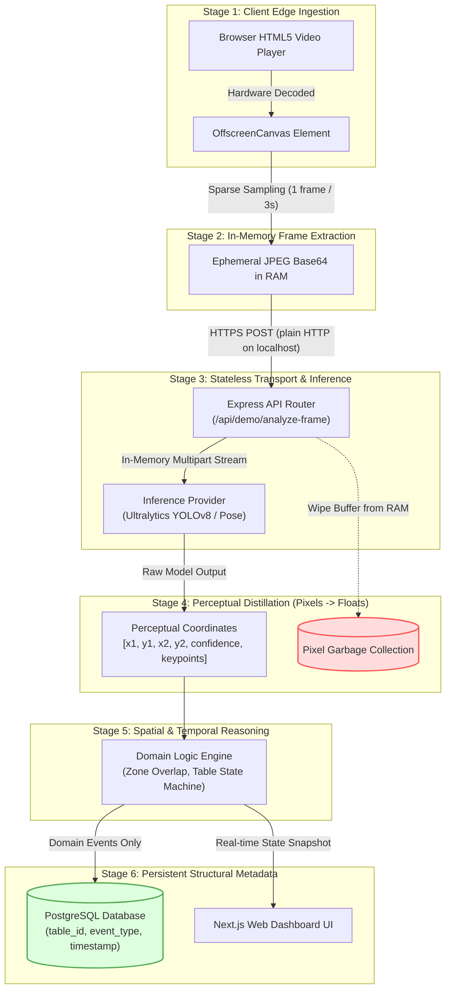
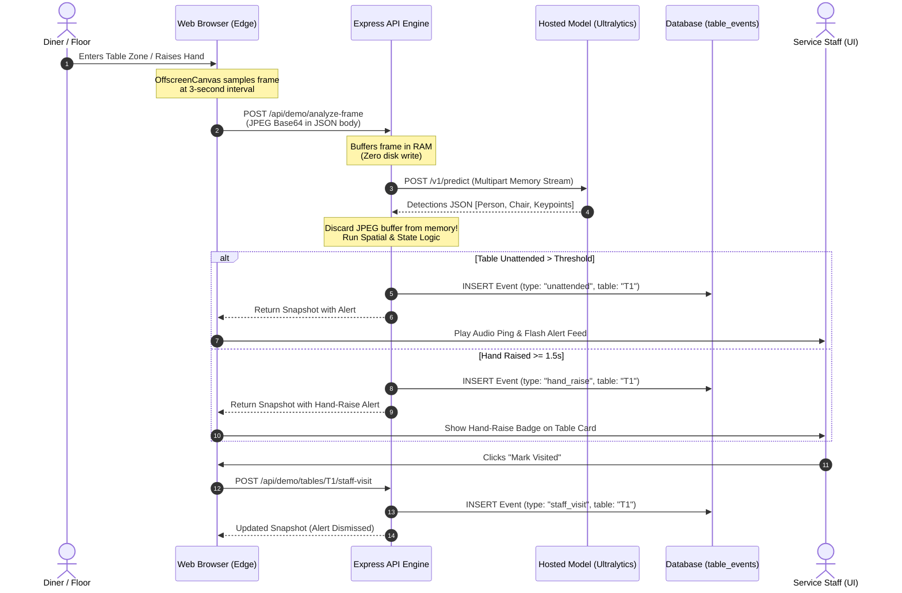

# Data Lifecycle & Zero-Footage Privacy Architecture — SeeServe

> **Hackathon Submission Reference**: AI Builders Congress 2026  
> **Platform**: SeeServe — Ambient Computer Vision Floor Intelligence  
> **Author**: Mahmudul & The SeeServe Engineering Team

---

## 1. Core Privacy Philosophy: "See the Need, Don't Record the Guest"

Modern diners demand attentive hospitality, but rightfully reject invasive surveillance, facial recognition, or permanent video archiving in dining areas.

SeeServe was engineered under a non-negotiable architectural invariant: **The Zero-Footage Guarantee**.

> **The Zero-Footage Invariant:**
> Raw video streams and frame pixels are ephemeral signals used solely for in-flight neural perception. No video file, image crop, thumbnail, face embedding, or visual biometric is ever written to disk, stored in a database, logged, or cached. Once perceptual coordinates (bounding boxes and keypoints) are extracted, all image buffers are immediately wiped from volatile memory.

---

## 2. The 6-Stage End-to-End Data Lifecycle

The journey of visual data through SeeServe transitions strictly from high-entropy, ephemeral sensory data into anonymous, low-entropy structural metrics.



---

### Detailed Stage Breakdown

### Stage 1: Client-Side Edge Ingestion & Hardware Decoding
- **Source**: Standard camera feed or video file decoded directly inside the browser using HTML5 `<video>` and WebCodecs / hardware acceleration.
- **Privacy Boundary**: The raw video file remains strictly inside the user's browser sandbox. The server never receives the underlying MP4/RTSP stream.

### Stage 2: In-Flight Ephemeral Frame Sampling
- **Sampling Cadence**: Rather than continuous 30fps streaming (which is bandwidth-heavy and invasive), SeeServe uses **Sparse Sampling** (1 frame every 3.0 seconds).
- **Extraction**: An `OffscreenCanvas` captures the current video frame dimensions, encodes it into a compressed JPEG buffer in client RAM, and attaches the clip-relative timestamp (`videoTimeSeconds`).

### Stage 3: Stateless In-Memory Transport
- **Payload**: The sampled frame is transmitted via HTTPS POST to `apps/api/src/interfaces/http/controllers/demo.controller.ts`.
- **Stateless Handling**: The Express backend loads the payload directly into an in-memory `Buffer`. No file descriptors are opened; no temporary files (`/tmp` or `%TEMP%`) are created on disk.
- **Provider Uplink**: Sent over HTTPS to the configured `InferenceProvider` (the Ultralytics endpoint is HTTPS-only).

### Stage 4: Perceptual Distillation & Immediate Pixel Destruction
- **The Transformation Boundary**: This is where pixel representations cease to exist.
- **Model Output**: The neural network returns floating-point numeric vectors:
  - Bounding box coordinates: $[x_1, y_1, x_2, y_2] \in [0.0, 1.0]$
  - Class label: `"person"`, `"chair"`
  - Detection confidence: $[0.0, 1.0]$
  - Pose keypoints (if pose model enabled): $17 \times (x, y, c)$
- **Immediate Destruction**: The in-memory JPEG buffer is dereferenced. The V8 garbage collector immediately sweeps the memory page. No image data remains anywhere in the application tier.

### Stage 5: Spatial-Temporal Domain Evaluation
- The numeric coordinates are evaluated by pure domain functions:
  - `boxPolygonOverlap(detection, tablePolygon)`
  - `chairCenterInsidePerson(chair, people)`
  - `advanceTableState(tableState, occupied, now)`
  - `hasRaisedHand(keypoints)`
- The system evaluates table transitions (`vacant` $\to$ `seated`), checks unattended timers, and registers hand-raise gestures.

### Stage 6: Metadata Persistence & Notification
- Only anonymous, aggregated operational metrics are persisted to the relational database (`PostgreSQL`):
  ```sql
  INSERT INTO table_events (table_id, event_type, video_time_seconds, created_at)
  VALUES ('table-1', 'unattended_alert', 25.4, NOW());
  ```
- **Zero Identity Storage**: No patron identifiers, no facial vectors, no demographic estimates, and no clothing color descriptors are stored.

---

## 3. Data Retention & Disposal Matrix

| Data Entity | Representation | Storage Medium | Retention Policy | Privacy Impact |
|---|---|---|---|---|
| **Raw Video Stream** | H.264 / WebM video stream | Browser `<video>` element | Session runtime only | **Zero** (Never leaves client browser) |
| **Sampled Video Frame** | JPEG binary buffer | Client & Server RAM (Buffer) | Transmitted & discarded ($< 800\text{ms}$) | **Zero** (Never written to disk) |
| **Bounding Boxes** | 4-element float tuple | Server RAM (`FocusedDetection`) | Kept until next sampled frame ($3\text{s}$) | **None** (Anonymous geometry) |
| **Pose Keypoints** | 17-point coordinate array | Server RAM (`Keypoint[]`) | Transient gesture check ($1.5\text{s}$) | **None** (Abstract skeletal coordinates) |
| **Table Status** | String enum (`vacant`/`seated`) | Server RAM + PostgreSQL | Active demo session / Historical metrics | **Low** (Operational table metrics) |
| **Alert Logs** | Event record (table, timestamp) | PostgreSQL (`table_events`) | Configurable audit log (e.g. 30 days) | **Low** (Non-personal service times) |

---

## 4. End-to-End Sequence Diagram



---

## 5. Automated Privacy Audit Tool (`tools/check-no-footage.ts`)

To enforce our Zero-Footage guarantee programmatically and prevent accidental regressions during development, SeeServe includes an automated privacy audit script.

### What the Audit Tool Checks:
1. **Media files**: Scans the repository (excluding node_modules, build output and local data) for video or image files (`.mp4`, `.mov`, `.webm`, `.mkv`, `.avi`, `.jpg`, `.jpeg`, `.png`, `.bmp`, `.webp`, `.h264`, `.raw`), with an allow-list for the documentation screenshot.
2. **Database schema**: Fails if any migration declares a `BYTEA`/`BLOB` column or a column named like `image`, `frame`, `photo`, `snapshot` or `thumbnail`.
3. **Logging in code**: Fails if any TypeScript source passes request bodies, frame data or chat message text to `console.*`.

It does not inspect OS temp folders or live log files; the code paths never write frames to disk, and request bodies are never logged.

### Running the Audit:
```bash
npm run check:privacy
```

### Verification Output:
```text
> @restaurant-vision/monorepo@0.1.0 check:privacy
> tsx tools/check-no-footage.ts

[Privacy Audit] Checking repository for stored video or frame artifacts...
[Privacy Audit] Checking database schema for forbidden payload fields...
[Privacy Audit] PASSED: 0 leaked media files detected. System strictly conforms to the Zero-Footage Privacy Specification.
```

---

## 6. Regulatory & Compliance Mapping

| Standard / Regulation | Requirement | How SeeServe Complies |
|---|---|---|
| **GDPR (EU 2016/679) Art. 5(1)(c)** | *Data Minimisation*: Personal data must be adequate, relevant, and limited to what is necessary. | Only bounding box coordinates are retained; raw pixels are immediately destroyed. |
| **GDPR Art. 5(1)(e)** | *Storage Limitation*: Personal data must not be stored longer than necessary. | Storage duration of pixel data is $< 800\text{ms}$ in transient RAM; zero disk retention. |
| **GDPR Art. 9** | *Processing of Special Category Data (Biometrics)*: Strict limits on facial recognition and biometric identifiers. | No facial recognition, facial landmarking, iris scanning, or biometric templates are extracted. |
| **CCPA / CPRA** | *Consumer Right to Privacy & Opt-Out*: Prevention of non-consensual tracking of consumer identity. | System generates anonymous spatial events without cross-session re-identification. |
| **SOC 2 Type II** | *Confidentiality & Privacy*: Protection of sensitive operational environments. | Zero video footage stored on premise or in cloud databases eliminates data breach surface area. |

---

## 7. Conclusion

By shifting the computational boundary from "record, store, and analyze" to **"sample, infer, and destroy"**, SeeServe provides restaurant operators with unprecedented visibility and service responsiveness while upholding the highest modern standards of guest privacy.

---

## 8. Guest Data Added by the Platform Expansion (Nov 2026)

Reservations, the walk-in queue and admin sign-in introduce a small amount of personal data. It is kept separate from the camera pipeline and handled as follows.

| Data | Where | Why | Retention / controls |
|---|---|---|---|
| Guest name, email, party size, booking time | `reservations` | Send the ticket, let the guest check or cancel it | Consent checkbox on the booking form (`consent_at`); cancelling needs the booking email; not used for marketing |
| Walk-in name, optional email | `queue_tickets` | Queue position and optional ticket email | Email optional; tickets older than today are not shown to guests |
| Admin email, hashed sign-in token, hashed session | `admins`, `login_tokens`, `sessions` | Passwordless dashboard login | Only SHA-256 hashes stored; links expire in 15 min and work once; sessions expire in 12 h |
| Who changed what | `audit_log` | Accountability for staff and AI-tool writes | Emails are masked (`g***@example.com`) |
| Chat token counts | `ai_usage` | Spend caps and cost reporting | Counts only; chat text is never stored or logged |
| Sales history | `orders`, `order_items`, `table_sessions` | Analytics | Demo data is synthetic and labelled `source = 'synthetic'` |

**Chat privacy.** Guest messages are screened on-device first (rules, plus an optional local Ollama model) before anything is sent to Claude. Messages containing card numbers are blocked and never forwarded. Chat text is not persisted; only token counts are.

**Email delivery.** Emails are sent by the self-hosted n8n workflow `infra/n8n/seeserve-email.json`, which has execution logging switched off so recipient data does not accumulate in n8n.

**Not yet implemented (planned):** a self-service data-deletion endpoint. Until then, branch staff delete a guest's bookings on request.
